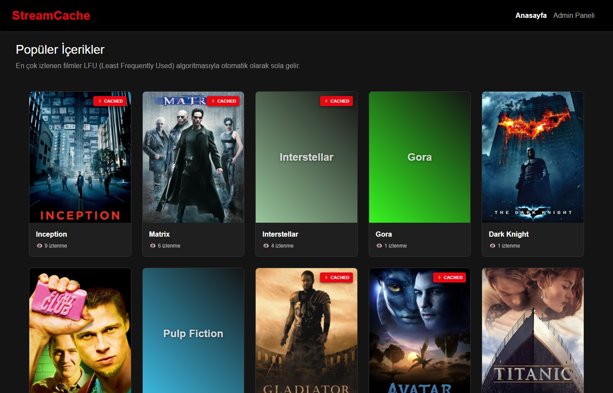
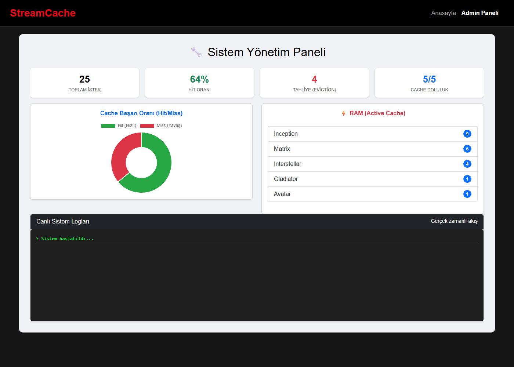

# 🎬 StreamCache

**LFU (Least Frequently Used) önbellek algoritmasını canlı olarak gözlemleyebileceğiniz, Netflix tarzı bir film platformu simülasyonu.**

Bir filme tıkladığınızda istek önce **RAM'deki önbelleğe** bakar; film orada yoksa veritabanından okunur ve önbelleğe alınır. Önbellek dolduğunda **en az izlenen** film tahliye edilir. Tüm bu süreç, süre ölçümleri (µs) ve istatistiklerle birlikte yönetim panelinden izlenebilir.


## 📸 Ekran Görüntüleri

### Anasayfa – izlenme sayısına göre sıralanan film kataloğu
`⚡ CACHED` rozeti, filmin şu anda RAM'de olduğunu gösterir.



### Admin Paneli – canlı önbellek istatistikleri
Toplam istek, hit oranı, tahliye sayısı, cache doluluğu, Hit/Miss grafiği ve aktif cache içeriği (2 saniyede bir otomatik yenilenir).



## ✨ Özellikler

- **LFU tahliye politikası** – `PriorityQueue` (min-heap) ile en az kullanılan film seçilir; eşitlik durumunda **en eski kullanılan** (LRU) tahliye edilir.
- **Read-through cache** – Hit durumunda veritabanına okuma yapılmaz; Miss durumunda film DB'den çekilip cache'e alınır.
- **Süre ölçümü** – Her isteğin süresi mikrosaniye cinsinden döner, böylece HIT ile MISS farkı görülebilir.
- **Thread-safe servis** – Cache haritası ve heap, eşzamanlı isteklerde birbirinden kopmaz.
- **Canlı admin paneli** – İstatistikler, doughnut grafik, RAM içeriği ve sistem logları.
- **Ayarlanabilir kapasite** – `cache.capacity` ile cache boyutu değiştirilebilir (varsayılan: 5).
- **Kurulumsuz demo** – `demo` profili ile PostgreSQL olmadan, bellek içi H2 veritabanıyla çalışır.
- **Birim testleri** – LFU, tie-break, istatistik ve hata durumları test edilmiştir.

## 🏗️ Mimari

```
Tarayıcı (index.html)
        │  REST
        ▼
MovieController ──► MovieCacheService ──► MovieRepository ──► PostgreSQL / H2
                     ├─ HashMap<id, entry>   (O(1) arama)
                     └─ PriorityQueue        (LFU + LRU tie-break)
```

| Katman | Dosya |
|---|---|
| Controller | `controller/MovieController.java` |
| Cache servisi | `service/MovieCacheService.java` |
| Veri erişimi | `repository/MovieRepository.java` |
| Örnek veri | `config/MovieDataInitializer.java` (yalnızca DB boşsa yükler) |
| Arayüz | `resources/static/index.html` |

## 🔌 API

| Endpoint | Açıklama |
|---|---|
| `GET /api/movies/{id}` | Filmi getirir; `CACHE HIT` / `CACHE MISS` bilgisi ve süre döner. Film yoksa `404`. |
| `GET /api/movies/list` | Tüm filmler, izlenme sayısına göre azalan sırada |
| `GET /api/cache-content` | Şu an RAM'deki filmler |
| `GET /api/stats` | `totalRequests`, `cacheHits`, `cacheMisses`, `evictions`, `capacity`, `cacheSize`, `hitRatio` |

## 🚀 Çalıştırma

Gereksinimler: **Java 17+** (Maven wrapper projeyle birlikte gelir).

### Hızlı deneme (veritabanı gerekmez)

```bash
./mvnw spring-boot:run -Dspring-boot.run.profiles=demo
```

Windows'ta `mvnw.cmd` kullanın. Ardından <http://localhost:9090> adresini açın. Admin paneli için: <http://localhost:9090/#admin>

### PostgreSQL ile

```sql
CREATE DATABASE movie_cache_db;
```

```bash
export DB_PASSWORD=sifreniz        # Windows PowerShell: $env:DB_PASSWORD="sifreniz"
./mvnw spring-boot:run
```

İsteğe bağlı ortam değişkenleri: `DB_URL`, `DB_USERNAME` (varsayılanlar `application.properties` içindedir).

## ⚙️ Yapılandırma

| Özellik | Varsayılan | Açıklama |
|---|---|---|
| `cache.capacity` | `5` | Cache'te tutulabilecek maksimum film sayısı |
| `server.port` | `9090` | Sunucu portu |
| `DB_URL` | `jdbc:postgresql://localhost:5432/movie_cache_db` | Veritabanı bağlantısı |
| `DB_USERNAME` | `postgres` | Veritabanı kullanıcısı |
| `DB_PASSWORD` | _(boş)_ | Veritabanı şifresi |

## 🧪 Testler

```bash
./mvnw test
```

## 🧠 LFU Nasıl Çalışır?

1. İstek gelir → film cache'te varsa **HIT**: sayaç artar, heap güncellenir.
2. Yoksa **MISS**: film DB'den okunur, sayacı artırılır ve cache'e eklenir.
3. Cache doluysa heap'in tepesindeki (**en düşük izlenme sayısına** sahip, eşitse en eski kullanılan) film tahliye edilir.

Bir filmi art arda izleyerek popüler yapın, ardından yeni filmler açıp hangisinin RAM'den atıldığını admin panelinden izleyin.
